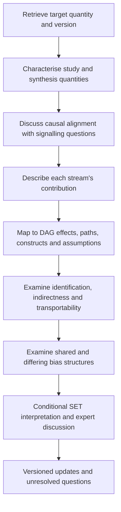

# Component B — Causal alignment assessment and triangulation at SET stage (v0.4)

*Methods guidance draft — for discussion; not adopted GALENOS protocol requirements. Companion document: see the Causal Graphs Quarto site.*

---

**Development status**

**Exploratory methodological guidance, not a validated instrument, scoring system or adopted GALENOS procedure.** Intended to support reflective expert discussion. The signalling questions and broad descriptions below are provisional. Particularly, **B5 responses require co-development with a multidisciplinary expert group**. Companion: Component A — Estimand Specification Guidance. Existing Quarto, protocol and SET files remain unchanged.

**v0.2 changes:** defines the Summary of Evidence on Mediators (SEM) and handles reviews without a numerical target estimand (B1a-i); adds stream-level estimands to the alignment record; separates the examination of shared and differing bias structures into its own step (B3); states the alignment-versus-indirectness distinction and how double counting is avoided; fixes the placement of the alignment narrative below the SET table; adds an illustrative TAAR1 narrative record; and moves inter-rater consistency to future evaluation (B6).

**v0.3 changes:** adds the fit with the four-step triangulation worksheet (Preparation, Step 1 Map, Step 2 Compare, Step 3 Examine bias, Step 4 Revise and record), so this component can be integrated with the worksheet page of the Causal Graphs Quarto site without restructuring.

**v0.4 changes:** renames the construct **"estimand alignment" → "causal alignment assessment"**, harmonising terminology across the methods paper, this guidance, and the Quarto site ("estimand alignment" remains the precise sub-term where the judgement concerns a numerical estimand specifically); adds the **integration level** (A common effect / B related but non-identical / C different links) that the alignment judgements resolve into; and adds **edge status** recording (supported / unsupported / uncertain / not adequately investigated) to the versioned-update proposal.

> **Guiding proposition:** The SET could become the point at which researchers explicitly assess how far the synthesised evidence supports the target estimand, rather than interpreting agreement or disagreement between summary estimates alone.

## Purpose and place in the review

The purpose is to make visible (1) the question or estimand targeted in the protocol, (2) what studies and their synthesis actually estimate or describe, (3) the evidence's specific contribution to the target, and (4) the identifying, bias, measurement and transportability assumptions underlying any connection. This assessment comes **before or alongside DAG mapping**, not after declaring cross-stream agreement.

This scaffold complements, not replaces, conventional risk-of-bias or indirectness assessments, statistical synthesis, the existing GALENOS Summary of Evidence table (SET / originally SoE), or the Summary of Evidence on Mediators (SEM).

**The Summary of Evidence on Mediators (SEM)** is the synthesis output of the hypothesis-generating route: a structured summary of the evidence relevant to each candidate mediator relationship (for example, exposure→mediator and mediator→outcome links), from which a consensus meeting selects the mediators carried forward. It is a *table of evidence about proposed pathway components*, not a diagram, and not a structural equation model. Where a diagram is meant, this guidance says **causal graph** — used as an umbrella term, following Component A, for DAGs, causal DAGs, path diagrams and related visualisations of assumed relationships between variables; an arrow counts as a causal claim only when it is given a causal interpretation.

### Suggested progression

### Fit with the four-step triangulation worksheet

The worksheet proposed for the triangulation meeting has four steps — **1 Map, 2 Compare, 3 Examine bias, 4 Revise and record** — plus preparation fields completed before the meeting. The progression above is the same process seen from the estimand side; the table shows where each part of this component is used. Teams already using the worksheet need to learn no new procedure: this component supplies the questions and records *within* each step.

| Worksheet step | Sections of this component | What happens | Artefact produced |
|---|---|---|---|
| **Preparation** (before the discussion) | B1a–B1a-i (opening questions); Component A §A3a | Retrieve the **versioned target specification** alongside the diagram, register and SET versions. Draft each stream's stream-level estimand and a first-pass characterisation of what the synthesis summarises. | Draft stream-level estimands in the meeting pack |
| **Step 1 · Map** | B2 (contribution types); B3 (mapping principle) | Place each stream's contribution on what it informs: an edge, a node, a proxy connection or an assumption — not automatically a single arrow. For hypothesis-generating reviews, map SEM rows to pathway components (B1a-i). | Contribution map with register IDs |
| **Step 2 · Compare** | B1a–B1c (alignment questions, dimensions, descriptors) | Discuss alignment using the dimension-specific questions; apply the alignment-versus-indirectness distinction so this step asks whether streams estimated the same *quantity*, while the SET's indirectness column records applicability. Ask whether apparent agreement could reflect different quantities rather than conflicting evidence. | Below-SET narrative record per stream (draft) |
| **Step 3 · Examine bias** | B3 (orthogonality check); B1b (bias-relevant dimensions) | Identification, indirectness and transportability per stream; then the named orthogonality check: shared versus differing bias mechanisms relative to each stream's *own* estimand, and whether a shared mechanism would produce the observed pattern. | Orthogonality judgement; bias notes keyed to register IDs |
| **Step 4 · Revise and record** | B5 (interpretative decisions); B6 (versioned updates) | Conditional SET interpretation; finalise the below-SET narrative records; route each change as an alignment re-interpretation, a DAG/register update, or a formal target amendment. | Final narrative records; versioned updates; actions and owners |

Three notes for integration:

1. **Steps 1 and 2 iterate; they do not sequence strictly.** Alignment assessment comes *before or alongside* causal-graph mapping, never after cross-stream agreement is declared. The worksheet order is compatible because Step 1 is a light mapping (what each stream informs); teams may move between Steps 1 and 2 until contributions and quantities settle.
2. **Preparation fields need a "target specification version".** The worksheet's before-the-discussion fields list diagram, register and SET versions; the target version retrieved in the progression above must be added so a meeting can be pinned to a dated target statement.
3. **Terminology:** "steps" refers to the four worksheet steps throughout; the lettered progression (A–I) is retained only as an internal map of this component.

## B1. Descriptive causal alignment assessment

> **Terminology note.** This guidance previously used "**estimand alignment**". The construct is now named **causal alignment assessment**, harmonised across the methods paper, this guidance, and the Quarto site. "Estimand alignment" remains the precise sub-term where the judgement concerns a numerical estimand specifically; "causal alignment assessment" is the umbrella term, covering pathway-level and non-quantitative contributions that have no numerical estimand.

### What does *alignment* mean here?

*Alignment* concerns whether the quantity represented by the evidence addresses the review's target, or a related but different quantity. It is **not synonymous** with internal validity, low risk of bias or clinical relevance. Evidence can be internally valid for its own estimand while being indirect for a different target. Conversely, an aligned estimand can be poorly estimated.

Use the questions as a discussion guide; **do not sum, score or mandate one categorical grade**. Briefly record the key similarities, differences, uncertainty and assumptions that matter most for interpreting the SET row.

### B1a. Opening questions before examining dimensions

- What exactly was the review target, and which version of that specification is being used?
- What did the included studies aim to estimate, and can that be inferred confidently from the reports?
- What does the synthesis summarise: a common effect, a distribution of study effects, an association, a qualitative pattern, or several distinct results?
- Does the evidence provide an estimate of the target or a contribution that must be interpreted through another assumption or causal pathway?
- Could an apparent agreement or discrepancy arise because **different quantities** were estimated rather than because studies yielded conflicting evidence?
- What quantity did *this stream* target in its own terms (the stream-level estimand, Component A §A3a)? Alignment is judged between two specified quantities, not between a study and an underspecified ambition.

### B1a-i. When the review has no numerical target estimand

Hypothesis-generating reviews may target candidate pathways or constructs rather than a single numerical quantity (Component A, question modes). In that case:

- The alignment question shifts from *does this quantity match the target quantity?* to *does this evidence inform the proposed relationship, its measurement, or the assumptions connecting its components?*
- The **SEM** (defined above) is the synthesis output whose rows are assessed; each SEM row concerns a candidate mediator relationship rather than a pooled treatment effect.
- The B1b dimensions on population, exposure, outcome and timing still apply; the *quantity / causal effect definition* and *synthesis target* dimensions are answered in relation to the pathway component the row addresses (for example, an exposure→mediator association rather than a mediated causal effect).
- The descriptive labels in B1c retain their meaning, with "target quantity" read as "target relationship or pathway component".

### B1b. Dimension-specific signalling questions

| Dimension | Signalling questions (examples) | What to record narratively |
|---|---|---|
| **Population / setting** | Who is represented by the study and synthesis? Who is in the target? Are age, diagnosis, species, severity, context or effect modifiers different? | Substantive differences and why they matter for applying findings |
| **Intervention / exposure / comparator** | Are dose, timing, treatment versions, assignment versus receipt and comparison conditions the same? Is a hypothetical intervention well-defined? | What contrast the evidence actually informs |
| **Outcome / construct / measurement** | Is the outcome the target construct, a different manifestation or a proxy? Could changes in measurement alter direction or meaning? | Direct measurement versus construct/proxy assumptions |
| **Timing** | Do exposure period, outcome follow-up, mediator order and treatment duration match? Are different periods scientifically comparable? | Relevant temporal mismatch or uncertainty |
| **Quantity / causal effect definition** | Is the target descriptive, associative or causal? Total effect, assignment effect, hypothetical adherence effect, direct or mediated effect? | Whether the studies answer the same kind of question |
| **Synthesis target / summary measure** | What does the pooled estimate or SWiM summary target? Are measures transformable? Does pooling over studies yield the target-population quantity? | Important distinctions between study, synthesis and review targets |
| **Intercurrent events (where relevant)** | How were discontinuation, switching, rescue treatment, competing events or outcomes undefined by death handled? Is this compatible with the target? | Meaningful divergences; distinguish missing data from intercurrent events |

### B1c. Broad interpretative descriptions — provisional language only

Use these phrases only where helpful for discussion, with an explanation of *which* dimensions are involved:

- **Closely aligned:** the stream addresses a compatible target quantity, notwithstanding methodological validity and applicability questions.
- **Partly aligned:** substantial correspondence, but a consequential difference or qualification remains.
- **Different but relevant:** the stream addresses a distinct quantity, yet can inform the target through a specified mechanism, proxy, context or assumption.
- **Connection unclear:** reporting or conceptual uncertainty prevents a defensible judgement.
- **No established link to this target:** currently no justified inferential connection; this does not mean the evidence has no other scientific value.

These are **descriptors, not categories with validated thresholds**, not necessarily exhaustive or mutually exclusive, and should not be forced into a global rating. The same stream may be closely aligned on intervention and distinctly different on population and outcome.

### From alignment judgements to the integration level

The alignment judgements resolve into the **integration level** for each pair or set of streams, which determines how they may be brought together:

- **A — Sufficiently common causal effect:** streams estimate effects defensibly related to one target estimand → quantitative integration may be possible (transformations, transportability assumptions, bias adjustment).
- **B — Related but non-identical effects or constructs:** streams address closely related questions but cannot defensibly be represented as observations of one target effect → retain within-stream quantitative synthesis; compare across streams without pooling.
- **C — Different links in a broader causal explanation:** streams inform different edges or propositions in the causal model → complementary, pathway-/question-level triangulation; "agreement" is not the operative concept.

The level is a recorded judgement with its rationale, not a score; borderline or mixed cases (for example, closely aligned on intervention, different on outcome) should be described per dimension as above.

### Alignment is not indirectness

The B1b dimensions overlap deliberately with the indirectness column of the existing SET, but the two judgements differ:

- **Indirectness** asks whether a stream's estimate *applies* to the review's target population, exposure, outcome or setting — a question of applicability of a quantity.
- **Alignment** asks whether the stream estimated the review's target *quantity at all* — a question about what was estimated, connected to the target only through stated assumptions.

Worked contrast (TAAR1, retrospective): the animal stream's estimate of reversal of challenge-induced hyperlocomotion can be *low* in indirectness for the animal stream's own estimand — right species, right paradigm, right outcome for that quantity — while being *maximally misaligned* with the human clinical target quantity, since it estimates a different effect on a different outcome in a different population, connected only through the contested proxy assumption A1. Conversely, a human trial restricted to adults under 65 may be closely aligned in quantity with the review target yet indirect for a target population that includes older adults.

**Avoiding double counting:** the SET's indirectness column assesses each stream's estimate against the review PICO; the alignment narrative (below the table) assesses whether the stream's quantity is the review's target quantity. Record each judgement once, in its place, and cross-reference rather than restate.

### Short narrative record (suggested, not a form)

> **SET row and target reference:** [review, outcome, target version, synthesis version].
>
> **Stream-level estimand:** [what this stream targeted in its own terms; Component A §A3a reference].
>
> **What is being summarised?** [one to three sentences on study-level variation and the synthesis target].
>
> **Main points of alignment or difference:** [key population, contrast, outcome, time and effect-definition considerations; not all dimensions need equal space].
>
> **Why this evidence contributes:** [direct/related/mechanistic/contextual/assumption-relevant contribution].
>
> **What must be assumed to connect it to the target?** [DAG/register references].
>
> **Unresolved questions for triangulation:** [reporting gaps, validity, transportability, bias and possible challenges].

The intention is to record *reasoning* rather than generate a new checklist score.

**Where the record lives.** The narrative record sits **below the SET table**, one per evidence-stream row (or per outcome where rows are dense). The SET's **Key Assumptions** column holds only the relationship informed, up to three typed assumption IDs with status, and links to the versioned DAG and register — consistent with the two-tier design principle in the Causal Assumptions and DAG Guidance: a small fixed set of fields in the table, the detailed reasoning in the linked record.

## B2. Ways evidence can contribute to a review target

**Classify evidential roles separately from alignment or risk of bias.** Multiple roles may apply; do not equate them with particular study designs.

| Provisional contribution description | Meaning | Example and caution |
|---|---|---|
| **Direct target contribution** | Intended to estimate the review target or a closely compatible quantity | Human trial of the relevant treatment and clinical outcome; still depends on identification, analysis and applicability |
| **Related-effect contribution** | Estimates a different but linked effect/association | Animal experimental contrast on behaviour is distinct from human clinical treatment effect |
| **Mechanistic contribution** | Informs a candidate process or pathway | Mediator measurement may support a hypothesis, but does not automatically identify a mediated causal effect |
| **Contextual contribution** | Informs intervention feasibility, meaning, measurement, setting or implementation | Qualitative experiences of heat, coping or access to cooling |
| **Assumption-testing contribution** | Supports, challenges or constrains an inference needed to relate evidence to the target | Independent evidence on behavioural proxy validity or exposure applicability |

**Signalling questions:**

- What would this contribution allow the panel to conclude that it could not otherwise conclude?
- Is it estimating a quantity, supporting a relationship, or interrogating an assumption?
- Does its claimed role rely on an untested bridge between species, populations, outcomes or interventions?
- What evidence would show the proposed contribution is overstated?

## B3. From alignment record to DAG/assumption mapping

### Mapping principle

Map the *inferential contribution*, not simply the name of the exposure and outcome. A **total causal effect** concerns all relevant causal pathways and should not automatically be assigned to a single direct arrow. Some contributions concern mediator nodes, outcome proxies, background context or identifying/transport assumptions rather than a DAG edge.

### Prompts before or during mapping

1. Is this estimate about the overall exposure–outcome effect, a specified component or an observed association?
2. Which relationship or candidate path, if any, is directly informed?
3. Does the stream instead inform the measurement of a construct, a proxy, effect modification, or assumptions about confounding and selection?
4. Where are there shared sources of systematic error across streams, notwithstanding differences in design?
5. Which assumptions must hold for findings on different effects/pathways to bear on a common target?
6. Which links are *not* supported, even if the direction of numerical results appears concordant?

### Orthogonality check: shared and differing bias structures

Apparent cross-stream agreement is only probative if it cannot be explained by shared systematic error. Treat this as a **distinct step between mapping and interpretation** (step G in the progression above), not a sub-question of bias assessment:

- List the key bias mechanisms for each stream (selection, measurement, reporting, confounding, analysis) relative to each stream's *own* estimand.
- Identify mechanisms that could operate in **both** streams — including shared publication practices, shared measurement instruments, shared populations, or animal-to-human assumptions that transmit bias in the same direction.
- Ask: if the shared mechanism operated, would it produce the observed pattern of agreement or disagreement?
- Record whether the differing-bias premise of the triangulation is *justified for this pair of streams*, or merely asserted by design labels (see the glossary entry on orthogonality in the Causal Graphs Quarto site).

Agreement between streams with plausibly shared bias should be reported as conditional in the same way as agreement resting on a contested proxy assumption.

### Connection with the existing assumption register

Use the established **draft** assumption types: structural, identifying, indirectness/applicability, proxy. Add references to assumptions by stable ID and version, with rationale and a possible challenge condition. Where bias direction can be defended, distinguish bias relative to a stream's *own* estimand from distortion of inference about the *review* target.

**Avoid:** treating a DAG as an empirical finding; asserting orthogonality merely because study designs differ; assuming opposite bias directions guarantee valid triangulation; or treating association/path coefficients as mediated causal effects without appropriate assumptions.

## B4. SET-stage Causal Alignment Record and retrospective TAAR1 illustration

### Where the record sits

The existing GALENOS association SET already accommodates summaries of results, within-study limitations, reporting bias, indirectness and other considerations. Draft DAG amendments propose linking rows to the assumption register and mapping to the DAG. As decided in B1c, the alignment narrative sits **below the SET table**, one per evidence-stream row; the **Key Assumptions** column holds only the relationship informed, typed assumption IDs with status, and links to the versioned DAG and register. Do not add multiple new columns before piloting feasibility.

**A compact SET summary might read:** “The human trial synthesis more directly addresses a human clinical treatment-effect question than the animal behavioural synthesis. The latter informs a distinct preclinical outcome, and its relevance to the clinical target depends on a contested proxy assumption and differences in treatment exposure. Alignment and bias concerns should be discussed separately.”

### TAAR1: illustrative alignment narrative (not a completed assessment)

| Item | Retrospective working interpretation |
|---|---|
| **Target** | Human therapeutic effect of TAAR1 agonism on psychotic symptoms; requires explicit definition of the target population, intervention strategy, endpoint, comparator, timing and summary measure |
| **Human RCT evidence** | Trial outcomes include PANSS total at 4–6 weeks; potentially closer to the clinical target, but the intended effect of assignment versus treatment received and applicability should be checked against study reports |
| **Animal experimental evidence** | Reversal of challenge-induced hyperlocomotion: an animal-specific intervention effect on a behavioural outcome, *not* the human clinical estimand |
| **Contribution descriptions** | Human stream: candidate direct-target contribution. Animal stream: related-effect and possibly mechanistic / assumption-relevant contribution, conditional on its actual design and measurements |
| **DAG and connecting assumptions** | A1 behavioural proxy validity; A2 dose/compound applicability; A5 trial-population applicability; A6 relevance of PANSS measurement (existing Quarto identifiers, all recorded there as contested) |
| **Outstanding interpretation** | What does apparent agreement across the animal and human results actually tell us about the human target, given the different outcomes and potentially different biases? |

**Illustrative narrative record — animal stream (retrospective reconstruction, for calibration only):**

> **SET row and target reference:** TAAR1 animal experimental evidence; target version [draft specification, Component A §A5].
>
> **Stream-level estimand:** Effect of [compound] versus vehicle on reversal of challenge-induced hyperlocomotion in [strains/paradigms as included], reported as [SMD].
>
> **What is being summarised?** Experimental contrasts across animal studies; the synthesis summarises a distribution of animal-specific effects, not the human clinical quantity.
>
> **Main points of alignment or difference:** Different population (species, challenge state), different intervention (preclinical dosing), different outcome (locomotor behaviour versus PANSS-assessed symptoms), different effect definition (experimental contrast, not a treatment-policy effect).
>
> **Why this evidence contributes:** Related-effect and mechanistic contribution; informs the proposed pathway and the behavioural-proxy assumption rather than the clinical target directly.
>
> **What must be assumed to connect it to the target?** A1 (behavioural proxy validity, contested) and A2 (dose/compound applicability, contested).
>
> **Unresolved questions for triangulation:** Whether proxy validity can be evaluated empirically; whether shared biases (for example, publication practices or selective outcome reporting operating across species) could produce concordant directions.

The blank template in B1c is retained unchanged for reuse.

**Questions for discussion:** What did each study estimate? Are the effects on comparable scales only after transformation, and would such a transformation preserve meaning? Does the animal stream inform a specific mechanistic hypothesis rather than the target effect? Which A1–A6 assumptions could be evaluated empirically? Are the human trial effects heterogeneous in a way that changes the synthesis target?

### Optional complementary example — LSR8 Heat & Mental Health

This is a prospective application of the *methods*, introduced after completion of the registered protocol. The existing Quarto materials identify human observational heat–mental health associations, candidate pathways and context-specific variables. Discuss which target(s) are associations and which hypothetical intervention effects would require new specification; do not invent an intervention-based target as a historical protocol fact. A future SET alignment narrative could clarify whether the pooled association describes a specified target setting, and what it says—if anything—about a defined heat-reduction intervention.

## B5. Towards interpretative and methodological decision guidance — expert workshop agenda

### Aim (not yet prescriptive guidance)

To co-develop **transparent principles for how reviewers should respond when evidence streams address partially aligned or distinct quantities**. The aim is not to create an automatic rule (“if partly aligned, do X”), nor to replace risk-of-bias or indirectness assessment. It is to define what panels should consider before deciding how to integrate — including choosing the integration level (A common effect; B related but non-identical; C different links in a pathway) — whether to pool, stratify, describe separately, triangulate conditionally, request missing information, or revise a review question or DAG.

### Questions to launch an expert workshop

**Meaning of alignment and importance of differences**
- Which types of difference are inferentially material? Does this depend on the decision context and target effect?
- Can reviewers distinguish different **estimands** from different **estimators**, analytic conventions or mere measurement scales?
- When are multiple synthesis-level targets acceptable under one review-level question?

**Action at synthesis and SET stages**
- Under what assumptions could two study results with differing estimands be meaningfully pooled? When is narrative comparison more defensible?
- What minimum description should accompany a SET row when targets are only partially aligned?
- How should a panel report agreement across related but non-identical effects without implying direct corroboration?
- What is the relationship between this process and existing indirectness, GRADE and risk-of-bias decisions? How can double counting be avoided?

**Causal and translational interpretation**
- What evidence would substantiate a proxy or transportability assumption, rather than merely make it plausible?
- Which shared biases might undermine apparent cross-stream agreement? Is likely bias direction genuinely assessable?
- When should evidence map to a total effect, path, node or assumption instead of a single DAG edge?

**Living-review changes and governance**
- What warrants a revised alignment interpretation versus a DAG/register update versus a formal target-estimand/protocol amendment?
- Who makes and records these decisions, and how should dissent or uncertainty be reported?
- Can teams use the framework consistently with feasible workload? What is the minimum viable documentation?

### Illustrative scenarios for discussion only — **not established recommendations**

| Possible finding | Illustrative option to debate | Why no fixed recommendation yet? |
|---|---|---|
| Study effects appear compatible with review target | Consider a common synthesis, where statistically and substantively defensible | Comparable labels do not prove common estimands or exchangeability |
| Substantial differences in contrast, population or follow-up | Explore separate summaries, subgroup analyses or qualified interpretation | Which differences matter and how much require context-specific judgement |
| Study estimand uncertain due to reporting | Seek protocols, author clarification, or document the uncertainty | Feasibility and implications vary between studies |
| Animal and human streams estimate related but different outcomes | Triangulate conditionally through named proxy/transportability assumptions | Proxy validity and causal pathways may remain contested |
| Synthesis target does not clearly match review target | Consider alternative synthesis approaches or qualify claims | An alternative model may not fix a fundamental target mismatch |
| New evidence challenges a bridge assumption | Revisit alignment narrative and assumption register | Challenge may concern an assumption, not the target scientific question |
| Evidence suggests the target should change | Discuss formal protocol amendment and preserve the previous version | Risk of post hoc redefinition after observing favourable results |

These scenarios are **stimuli for expert deliberation**, not a decision algorithm. Workshop outputs should capture competing perspectives, counterexamples and situations where no recommendation can yet be made.

### Suggested outputs of the workshop (for future consideration)

- Agreement on a minimal set of signalling questions and useful worked examples.
- Provisional guidance on explaining material alignment differences in a SET.
- A shared vocabulary for contribution types and assumption links.
- Clearer distinctions between alignment, identification, bias and transportability.
- A list of contested cases to pilot in retrospective and prospective LSR applications.

## B6. Living systematic review updates and evaluation

**Proposal for versioned records:**

- **Target quantity / estimand:** amend only when the question is intentionally redefined, with justification and provenance.
- **DAG / assumption register:** update as causal understanding and assessments evolve; date and archive changes. When a relationship in the DAG is revised, record its **edge status** — supported, unsupported, uncertain, or not adequately investigated — in the decision log, paralleling the status judgements in the assumption register.
- **Synthesis/SET alignment narrative:** revisit when studies or analyses change, when reporting becomes clearer, or when key assumptions are challenged.

**Pilot evaluation questions:** Can authors use the signalling questions without specialist facilitation? Does the record expose previously unspoken assumptions? Does it alter—or only document—the reasoning at the triangulation meeting? What workload does it add? Whether different expert groups identify the same major target mismatches is a question for **later formal evaluation**, once the signalling questions have stabilised through piloting.

## Research and methodological limitations to retain prominently

- No validated thresholds, inter-rater reliability results or formal rule set currently support the provisional descriptive categories in this draft.
- Not all review questions or qualitative contributions have a numerical causal estimand.
- A DAG does not itself identify the estimand or demonstrate its identification.
- Separate the evidential contribution and indirectness of a study from the risk of bias in estimating *its own* quantity.
- Agreement in direction between streams is not, on its own, evidence of a shared target or independent biases.

## Provenance and reading

**Existing project materials:** *D1 Template Amendment Pack v0.1*; draft GALENOS association and hypothesis-generating protocol amendments; Quarto `index.qmd`, `concepts.qmd`, `taar1.qmd`, `lsr8.qmd`, `reporting.qmd`, `worksheet.qmd`. They underpin the current SET/DAG/register workflow and the TAAR1/LSR8 examples. This **estimand alignment approach and its signalling questions are new proposals**, not attributed as established GALENOS requirements.

**Methodological sources:**
- ICH E9(R1). *Addendum on Estimands and Sensitivity Analysis in Clinical Trials* (2019). [Guidance](https://database.ich.org/sites/default/files/E9-R1_Step4_Guideline_2019_1203.pdf).
- Kahan BC, Devane D. *Estimands: what they are and why we should use them*. *Journal of Clinical Epidemiology* 189 (2026):112054. [DOI](https://doi.org/10.1016/j.jclinepi.2025.112054).
- Kahan BC et al. *The estimands framework: a primer on the ICH E9(R1) addendum*. *BMJ* (2024) 384:e076316. [DOI](https://doi.org/10.1136/bmj-2023-076316).
- Rodrigues D et al. *Reflection on modern methods: constructing directed acyclic graphs (DAGs) with domain experts for health services research*. *International Journal of Epidemiology* (2022). [DOI](https://doi.org/10.1093/ije/dyac135).
- Dijk SW et al. *Directed Acyclic Graphs in Decision-Analytic Modeling: Bridging Causal Inference and Effective Model Design in Medical Decision Making*. *Medical Decision Making* (2025). [DOI](https://doi.org/10.1177/0272989X241310898).

**Version history:** v0.1 (20 October 2026) initial draft. v0.2 defines the SEM and the no-numerical-estimand case (B1a-i), adds stream-level estimands to the alignment record, makes shared/differing bias structures a distinct orthogonality-check step, states the alignment-versus-indirectness distinction and SET placement, adds an illustrative TAAR1 narrative record, and moves inter-rater consistency to future evaluation. v0.3 adds the fit with the four-step triangulation worksheet (Preparation, Steps 1–4) for Quarto site integration.
