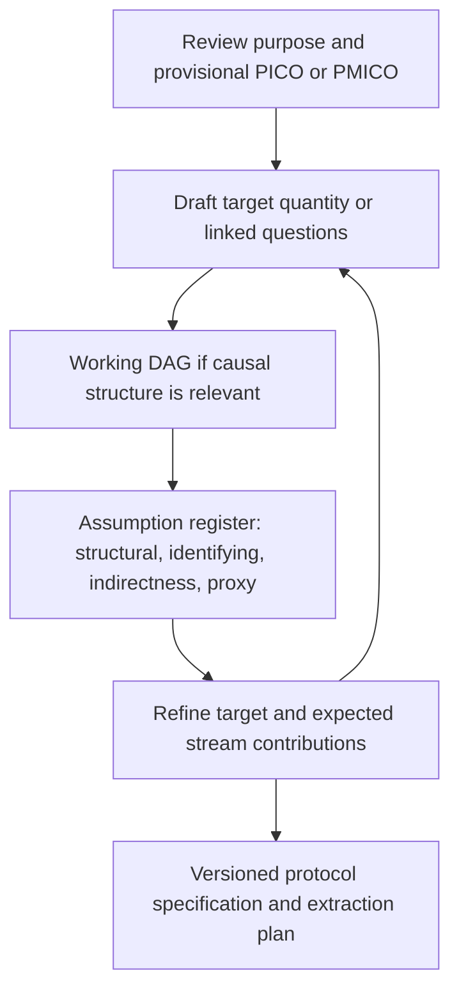

# Component A — Estimand specification at LSR protocol stage (v0.2)

*Methods guidance draft — for discussion; not adopted GALENOS protocol requirements. Companion document: see the Causal Graphs Quarto site.*

---

**Status and scope**

**Working methodological scaffold for expert discussion; not adopted GALENOS protocol requirements.** Intended for review authors with introductory and advanced guidance. Covers descriptive, associational, causal and hypothesis-generating questions. Works alongside—not instead of—PICO/PMICO, the versioned DAG and the assumption register. Companion: Component B — Estimand Alignment and Triangulation Guidance. Existing Quarto project and protocol files have not been modified.

**v0.2 changes:** adds stream-level estimand specification (A3a), a PICO/PMICO crosswalk and template-routing rule, governance of the target statement (A7), sensitivity-analysis wording for the assumption register, extraction guidance, and an illustrative completed TAAR1 target statement (A5). These components are intended for integration into the Causal Graphs Quarto site rather than distribution as stand-alone requirements; worksheet and template sections are kept self-contained so they can be copied into separate methods guidance documents.

## Purpose and expected outputs

The purpose is to help a living systematic review (LSR) team specify *what quantity or scientific relationship it wants to learn about* early enough to shape eligibility, extraction, synthesis and triangulation. Not every review targets an identifiable causal effect. The intended outputs are: (1) a versioned statement of the target quantity/estimand and linked questions; (2) an explicit account of what remains uncertain; (3) an initial evidence-contribution map; and, where appropriate, (4) a versioned DAG with linked assumptions.

The process is **iterative**: provisional question ↔ candidate target quantity ↔ causal structure and assumptions ↔ refined question. Do not treat a diagram as proving the relationships it represents.

### Position within the wider methods development

This component is the **estimand-specification layer** of the planned ESC-DAG architecture for triangulating evidence streams. In that architecture: a **causal graph** represents the shared causal pathway and the evidence regimes that inform it (structure); this component specifies **what quantity each question and each evidence stream targets** (specification); Component B assesses how stream-level quantities relate to the review target at synthesis (alignment); and quantitative extensions — including formal bias correction — are a separate, later workstream that would attach to, but is not required for, this framework. The framework can be adopted for qualitative, workflow-embedded use on its own.

**Terminology — "causal graph" as an umbrella term.** Throughout both components, *causal graph* is used as an umbrella for DAGs, causal DAGs, path diagrams and related visualisations of assumed relationships between variables. An arrow counts as a causal claim only when it is given a causal interpretation; a diagram drawn to display associations or statistical model structure (for example, a structural equation model path diagram) functions as a causal graph only under that interpretation. Note also that in GALENOS materials **SEM** means *Summary of Evidence on Mediators* — a synthesis output defined in Component B — and not a structural equation model.

## A1. Conceptual guidance — what is an estimand?

### Introductory layer

An **estimand** is a precisely specified quantity that an analysis seeks to estimate. In an intervention review it may be a causal contrast—for instance, the mean difference in symptom scores at a defined time under two specified treatment strategies in a specified population. In an association review it can instead be a defined association parameter (including precisely what, if anything, is conditioned on). A descriptive review may target prevalence. A hypothesis-generating review can articulate candidate relationships and scientific questions without presuming it has a single numerical estimand.

**Illustrative broad question:** Does treatment X improve depressive symptoms?

**A more explicit causal target (illustrative, not a GALENOS decision):** Among adults with a specified depressive disorder, what is the population-average difference in a specified symptom score eight weeks after assignment to treatment X versus comparator Y, regardless of subsequent treatment discontinuation?

| Distinction | Meaning | What to check in an LSR |
|---|---|---|
| Review question / PICO or PMICO | Scope and motivation | Does it specify the target sufficiently to interpret results? |
| Target estimand / target quantity | The precisely defined quantity of interest | Population, comparison, outcome, timing, summary and relevant post-baseline events |
| Estimator | The analytical procedure | Is the meta-analytic or study estimator appropriate for the target? |
| Estimate | Numerical output | What is the estimate actually a result *of*? |
| Identification | Assumptions connecting observed data to a target causal effect | Is a causal interpretation warranted, and conditional on what? |

**Why this matters:** Two studies may meet the same PICO while estimating assignment effects, hypothetical fully-adherent effects, different follow-up effects or associations with different adjustment sets. Pooling them does not automatically reconcile these differences. Conversely, two studies estimating different quantities may both provide useful *non-identical* contributions to triangulation.

### Advanced layer: distinctions to keep explicit

- **Target versus identification:** An estimand can be specified even if the available data cannot identify it.
- **Target versus synthesis output:** A random-effects pooled estimate may describe the mean of a distribution of study effects; it need not equal the target-population average effect. Specify the meta-analytic target and the assumptions needed to connect it to the review target.
- **Causal versus associational:** A covariate-adjusted coefficient is not automatically a causal estimand; adjustment may change the associational parameter and can create bias under certain causal structures.
- **Treatment strategy and intercurrent events:** In intervention studies, discontinuation, switching or rescue treatment can distinguish treatment-policy, hypothetical and other estimands. Missing outcome data are a separate issue, although the two can interact.
- **Mechanism versus mediation estimand:** A candidate mediator and an exposure–mediator association are not by themselves an identified natural or interventional indirect effect. Mediator–outcome confounding, timing and additional assumptions matter.
- **Multi-stream contributions:** Qualitative evidence can inform intervention meaning, context and mechanisms without being a numerical estimator of the review target.
- **Stream-level estimands:** Specify an estimand for each evidence stream, not only for the review. The human and animal streams in a translational review target different quantities in different populations; alignment (Component B) is then a relation between two specified quantities rather than between a study and an underspecified ambition. See A3a.

### Questions for the review team

- If two authors interpreted the target independently, would they describe the same population, exposure contrast and outcome?
- Would a trial of treatment assignment and an observational treatment-received analysis answer the *same* question?
- Are we actually interested in an association, a causal intervention effect, or candidate causal pathways?

## A2. Practical decision guide — select the question mode

**Step 1: State the intended use of the answer** (scientific explanation, clinical decision, intervention development, surveillance, etc.).

**Step 2: Select all applicable review purposes; do not force a single category.**

| Guiding question | Likely target | Questions before proceeding |
|---|---|---|
| How frequent/common is the phenomenon? | Descriptive target | What population, denominator, period and definition? |
| How are X and Y related in observed data? | Associational estimand | Marginal or adjusted association? Adjusted for what, and why? |
| What would happen if X were changed by a defined intervention? | Causal estimand | What intervention versions, comparator and relevant counterfactual assumptions? |
| What mechanisms might connect X and Y? | Linked mechanistic hypotheses; potentially several estimands | Is the goal to identify candidate pathways, estimate pathway-specific effects, or test a specified mediation estimand? |

**Step 3: For mixed-mode reviews**, nominate a primary target where feasible and record linked secondary questions; do not collapse all mechanisms into one treatment-effect estimand.

**Step 4: Flag unresolved decisions.** “Not defined yet” is preferable to invented specificity.

**Design does not determine question mode**

An RCT can report an associational or causal quantity depending on the question and analysis; observational designs may target causal estimands under assumptions; animal experiments are not necessarily limited to mechanistic contributions.

## A3. Specification worksheet — review-team prompts

Copy this section into a review-specific note. Complete provisionally, discuss ambiguities, and revise after causal-structure discussion.

| Step | Signalling question | Provisional answer / unresolved issue |
|---|---|---|
| 1. Purpose | What decision or scientific explanation motivates the review? | _To complete_ |
| 2. Mode | Descriptive, association, causal, hypothesis-generating or mixed? Why? | _To complete_ |
| 3. Target population | Who or what should the answer apply to? Setting and eligibility? | _To complete_ |
| 4. Exposure/intervention | What are the relevant level(s), versions, duration and implementation? | _To complete_ |
| 5. Comparator | Compared with what observable or hypothetical alternative? | _To complete_ |
| 6. Outcome/construct | What is the *target construct*, and by what measure and direction? | _To complete_ |
| 7. Timing | When are exposure, mediator (if any) and outcome assessed? | _To complete_ |
| 8. Summary quantity | Risk difference/ratio, mean difference, prevalence, association slope, etc.? | _To complete_ |
| 9. Intercurrent events | Which events change interpretation/existence of outcome? Which strategy addresses them (if applicable)? | _To complete_ |
| 10. Effect type | Total effect? A specified direct or indirect effect? Conditional or marginal? | _To complete_ |
| 11. Evidence streams | Which streams might estimate the target? Which could inform related effects, pathways, context or assumptions? | _To complete_ |
| 12. Assumptions | What must be true to interpret or transport stream findings to this target? | _To complete_ |
| 13. Open questions | What still needs expert, stakeholder or methodological input? | _To complete_ |

### Crosswalk with PICO/PMICO and the template routes

The worksheet extends, rather than replaces, existing question frameworks. Each step maps to familiar elements:

| Worksheet step | PICO/PMICO element | Where the output is used |
|---|---|---|
| 1. Purpose | Justification / rationale | Protocol background |
| 2. Mode | Review question type | Determines template route (see routing rule below) |
| 3. Target population | Population (P) | Eligibility criteria; synthesis target |
| 4. Exposure/intervention | Intervention / Exposure (I/E) | Eligibility; extraction of the contrast |
| 5. Comparator | Comparator (C) | Eligibility; extraction of the contrast |
| 6. Outcome/construct | Outcome (O) / Mechanism (M) | Eligibility; measurement extraction |
| 7. Timing | (Usually implicit in PICO) | Eligibility; extraction of follow-up |
| 8. Summary quantity | (Not a PICO element) | Synthesis plan |
| 9. Intercurrent events | (Not a PICO element) | Extraction; interpretation of trial effects |
| 10. Effect type | (Not a PICO element) | Causal-graph discussion; synthesis plan |
| 11. Evidence streams | (Not a PICO element) | Evidence contribution map; stream-level estimands (A3a) |
| 12. Assumptions | (Not a PICO element) | Assumption register |
| 13. Open questions | — | Protocol limitations / next steps |

**Routing rule (proposed)**

Question mode does not determine template route, but the combination determines what else is required:
- **Descriptive or associational mode** in either route: a causal graph is optional; register indirectness and proxy assumptions where evidence streams will be compared.
- **Causal mode in the associations route:** triggers the DAG and assumption-register amendments, because the associations template contains no DAG by default.
- **Mechanistic or hypothesis-generating mode:** use the hypothesis-generating route, which recommends a causal graph and produces the Summary of Evidence on Mediators (SEM); link the SEM to the register (Component B).
- **Mixed-mode reviews:** declare the primary route and how linked questions are handled; do not force a mechanistic question into an associational template without the DAG amendments.

### Specifying stream-level estimands (A3a)

For each evidence stream nominated in worksheet step 11, specify the quantity that stream can estimate *in its own terms*. Illustrative TAAR1 application (placeholders to be confirmed against the included studies; not a completed assessment):

| Field | Human stream (TAAR1, illustrative) | Animal stream (TAAR1, illustrative) |
|---|---|---|
| Population | Adults with schizophrenia spectrum disorders in the included trials | The strains, sexes and challenge paradigms used in the included experiments |
| Intervention/exposure | Add-on TAAR1 agonist at trial doses | Compound at preclinical doses in a challenge-induced state |
| Comparator | Placebo add-on (or as reported) | Vehicle under challenge |
| Outcome/construct | PANSS total (a measure of the symptom construct) | Reversal of challenge-induced hyperlocomotion (a behavioural outcome) |
| Timing | 4–6 weeks | As reported per paradigm |
| Summary quantity | As reported (e.g. mean difference, SMD) | As reported (e.g. SMD) |
| Effect type | Assignment effect under the trials' strategies (to confirm) | Experimental contrast under each study's design |

The proxy assumption A1 is then a **bridge between two specified estimands** — a claim that the animal stream's quantity is informative about the human stream's construct — rather than a vague link between "animal studies" and "the human question". This makes A1 easier to state, challenge, and revise when a new paradigm or outcome measure appears.

### Writing the target statement

- **Causal template:** “In [target population], what is the [summary] of [outcome at time] under [intervention strategy] compared with [comparator strategy], treating [key intercurrent events] using [specified strategy]?”
- **Association template:** “In [population and period], what is the [marginal/conditional association measure] between [defined exposure] and [outcome at time], with [conditioning variables/standardisation]?”
- **Descriptive template:** “In [population/period], what proportion/mean [well-defined property] is observed, measured by [definition]?”
- **Hypothesis-generating template:** “Which candidate variables or pathways might connect [exposure] and [outcome], and what forms of evidence could support or challenge the proposed relationships?”

These are **templates for clarification**, not guarantees of identification. In particular, causal exposure questions may require a well-defined intervention and alternative versions of treatment.

### Worked micro-example: heat

- Too broad: “Does heat cause depression?”
- More explicit proposed target: “Among [defined urban population], what is the average difference in [specified depressive symptom measure] over [specified period] under [precisely defined heat-reduction strategy] compared with [defined alternative]?”
- **Still unresolved:** Is the intervention air conditioning, environmental greening, changing exposure while holding other factors fixed, or another strategy? These may entail different estimands.

### Quality check before sign-off

- Can another reviewer reproduce the intended target from the text?
- Are proposed effects distinguishable from the statistical measures likely to be extracted?
- Are population/setting and time included?
- Have we documented uncertainty rather than silently assuming equivalence?
- Have relevant stakeholder priorities informed outcomes and contrasts?

## A4. Iterative link to DAGs and the assumption register

**Prompts while drawing/revising a DAG:**

- Is the target the **total** effect along all directed pathways, or a particular effect component? Do not confuse a total effect with one directed edge.
- Which putative common causes, mediators, colliders, selection processes and measurement mechanisms should be represented?
- Is an animal behavioural variable a *proxy* for a human clinical construct, rather than the same outcome?
- What adjustment/identification claims apply to each design? Which data are unavailable?
- Which effect modifiers, intervention differences and settings would matter for transportability?
- What evidence would challenge each assumed arrow or transportability/proxy claim?

**Assumption register fields (existing draft convention):** identifier; type (structural / identifying / indirectness / proxy); statement; affected streams or relationships; provisional status (agreed/contested/uncertain); rationale; potential falsifier/challenge; version/date. Status labels are discussion aids, not certainties.

**Sensitivity-analysis reading of the register.** The register's **potential falsifier/challenge** field is the qualitative analogue of the sensitivity analysis that ICH E9(R1) pairs with every estimand: it states, in advance, the evidence or reasoning that would undermine the assumption. Reviewers familiar with trial methodology can read it as the plan for the sensitivity analysis they would otherwise want to see, expressed in words rather than models.

**Versioning rule (proposal):** retain dated target versions and dated DAG/register versions separately. An evidential challenge to a mechanism does *not* automatically change the target; a changed review target needs an explicit, justified protocol amendment.

## A5. Worked applications (developmental, not completed assessments)

### Example 1 — TAAR1 in psychosis (retrospective)

**Grounded in the existing Quarto worked example:** human clinical outcomes include PANSS total at 4–6 weeks; animal experiments examine reversal of challenge-induced hyperlocomotion. The existing assumption register records A1 (animal behavioural proxy, contested), A2 (preclinical dose/compound relevance, contested), A5 (trial population applicability, contested) and A6 (PANSS measurement relevance, contested). The Quarto application is retrospective; do not imply these target definitions were prespecified in the historic protocol.

| Worksheet aspect | Provisional application |
|---|---|
| Review target | Human therapeutic effect of TAAR1 agonism on psychotic symptoms; **requires further specification** of target population, treatment strategy/comparator, symptom endpoint, timing and summary |
| Human stream | Trial effects on PANSS total after 4–6 weeks; check whether assignment/treatment strategy aligns with target |
| Animal stream | Distinct experimental contrast on locomotor behaviour; *not* a human clinical effect |
| DAG/assumption link | A1 and A2 connect animal evidence to the clinical hypothesis; A5 and A6 concern the clinical interpretation |
| Protocol lesson | Declare whether the review both evaluates effects/associations and generates mechanistic hypotheses; do not construct the pathway solely after seeing results |

**Illustrative completed target statement (hypothetical, for calibration only).** The retrospective TAAR1 materials do not contain a fully specified target; the following shows what a completed statement would look like. Bracketed content is a placeholder to be confirmed against the actual protocol and trials, not a claim about them:

> In [adults with schizophrenia spectrum disorders], what is the [mean difference] in [PANSS total score] at [4–6 weeks] under [add-on TAAR1 agonism at the doses used in the included trials, continued as assigned] compared with [placebo add-on], treating [treatment discontinuation and switching] using a [treatment-policy strategy]?

Even this statement leaves open whether the review's interest is the assignment effect (as stated), a hypothetical fully-adherent effect, or a mechanistic pathway — a decision the worksheet forces into the open rather than hides.

**Researcher discussion prompts:** Is PANSS total the target construct or an imperfect clinical measure? Does the animal contrast test an effect on a proxy, a proposed pathway, or both? What are the study-specific treatment strategies? What would make the clinical/animal convergence probative?

### Example 2 — LSR8 Heat & Mental Health (ongoing, prospective application)

**Existing Quarto status:** an ongoing application introduced after the original protocol, with draft DAG package v1.1, candidate confounders, ambient-heat exposure distinctions, biological/psychological/social-behavioural mediator detail and an assumption register. The available project materials do **not** establish one final causal estimand; avoid representing a hypothetical heat-reduction intervention as prespecified.

| Worksheet aspect | Development question |
|---|---|
| Review mode | Which questions are about observed heat–mental health associations, which about possible interventions, and which about pathways? |
| Exposure | Ambient temperature, personal heat exposure, heatwave exposure, indoor heat or an actionable cooling strategy? |
| Population | Which human groups, settings and vulnerability factors are the inferential target? |
| Outcome | Which mental health endpoints, periods and measurement instruments are eligible versus the target? |
| Streams | Human observational association; possible experimental/mechanistic evidence; animal models and contextual evidence where justified |
| Causal structure | When might sleep, cooling access/use, medication or other variables be mediators, confounders or modifiers? |

**Suggested pilot:** apply A3 prospectively to one LSR8 review question and document changes to the existing draft DAG and assumptions without retrospectively claiming they were in the registered protocol.

## A6. Optional protocol wording (proposal, not approved template text)

### For an associations / mixed-mode LSR

> We will specify the principal target quantity or estimand for each priority review question, identifying the target population, exposure/intervention and comparator, outcome and timing, and the summary quantity of interest. We will state whether the question is associational or causal and identify linked hypothesis-generating questions where relevant. Where causal interpretation is sought, we will iteratively develop a versioned working DAG and register assumptions about identification, structure, proxy outcomes and applicability. At synthesis and SET stages, we will assess how the quantities summarised by each evidence stream relate to the target before triangulation.

### For a hypothesis-generating LSR

> We will state the principal explanatory questions and candidate causal pathways without assuming that each question corresponds to a directly estimable mediated effect. We will identify any specific causal or associational estimands that are feasible, maintain a versioned DAG and assumption register, and document which evidence streams inform candidate relationships, constructs or assumptions. The Summary of Evidence on Mediators (SEM) and any SET-style triangulation summary will distinguish pathway-relevant evidence from identified causal effect estimates.

### Practical implementation notes

- Reference the detailed A3 worksheet rather than inserting it wholesale into the protocol.
- Record whether each specification is prespecified, prospectively amended, or reconstructed retrospectively.
- **Extraction follows the target.** Once specified, the target statement should shape what extractors collect: the treatment strategy and comparator actually used in each study, how intercurrent events were handled, the follow-up window, and the adjustment set for observational evidence. In prose terms: if the target names a treatment-policy strategy, extractors must record enough to tell whether a study's analysis matches it. Structured extraction fields keyed to estimand attributes are a planned next step in the development of these methods tools, not a requirement at this stage.
- Treat the existing GALENOS amendments as **proposals for review**, not agreed mandatory fields.

## A7. Governance of the target statement (proposal)

- **Drafting:** the review team drafts the target statement and stream-level estimands (A3a) at protocol stage, using the A3 worksheet.
- **Sign-off:** the statement is agreed with clinical, preclinical and methodological input before eligibility screening begins; experiential and stakeholder input informs the choice of outcomes and contrasts (worksheet steps 1 and 6).
- **Amendment:** any change to the target after sign-off requires a version increment, a dated justification, and a note of the evidence known at the time of the change (see the versioning rule in A4).
- **Disagreement:** where contributors disagree about the target or a stream-level estimand, record the disagreement and the positions held in the register rather than forcing consensus; unresolved disagreement is carried into triangulation as an explicit condition on interpretation.

These arrangements are proposals for discussion; GALENOS governance groups should confirm ownership and process.

## Development questions for expert review

1. Is *target quantity/estimand* sufficiently accessible across the four review modes?
2. Which A3 fields are essential for all questions, and which conditional?
3. Should the specification be per research question, outcome, or review-level target plus linked subquestions?
4. Does the iterative workflow create useful clarity beyond PICO/PMICO and existing DAG guidance?
5. What is the minimum documentation feasible for living updates?
6. Which aspects should be approved by clinical, preclinical, statistical and experiential stakeholders?
7. Is stream-level estimand specification (A3a) feasible for all evidence streams, including qualitative and contextual contributions that may not have a numerical estimand?

## Provenance and reading

**Existing GALENOS project materials consulted:** *D1 Template Amendment Pack v0.1* (October 2026; proposed, not approved); *Protocol Template for evaluating associations v3.2 — DAG amendments draft*; *Protocol Template Hypothesis Generating Review v2.2 — DAG amendments draft*; Quarto pages `index.qmd`, `concepts.qmd`, `taar1.qmd`, `lsr8.qmd` in *Casual Graphs Quarto.zip*. These documents underpin the descriptions of the current proposed workflow and examples. Material explicitly labelled “proposed” in this note is a further methodological extension.

**Foundational sources:**
- ICH E9(R1). *Addendum on Estimands and Sensitivity Analysis in Clinical Trials* (2019). [Regulatory guidance](https://database.ich.org/sites/default/files/E9-R1_Step4_Guideline_2019_1203.pdf).
- Kahan BC, Devane D. *Estimands: what they are and why we should use them*. *Journal of Clinical Epidemiology* 189 (2026):112054. [DOI](https://doi.org/10.1016/j.jclinepi.2025.112054).
- Kahan BC, Hindley J, Edwards M, Cro S, Morris TP. *The estimands framework: a primer on the ICH E9(R1) addendum*. *BMJ* (2024) 384:e076316. [DOI](https://doi.org/10.1136/bmj-2023-076316).
- Hernán MA, Robins JM. *Causal Inference: What If*. [Textbook](https://www.hsph.harvard.edu/miguel-hernan/causal-inference-book/).
- Dijk SW et al. *Directed Acyclic Graphs in Decision-Analytic Modeling: Bridging Causal Inference and Effective Model Design in Medical Decision Making*. *Medical Decision Making* (2025). [DOI](https://doi.org/10.1177/0272989X241310898).

**Version history:** v0.1 (20 October 2026) initial draft. v0.2 adds stream-level estimand specification (A3a), the PICO/PMICO crosswalk and routing rule, the governance section (A7), sensitivity-analysis wording for the register, extraction guidance, the ESC-DAG positioning and causal-graph terminology note, and the illustrative completed TAAR1 target statement.
